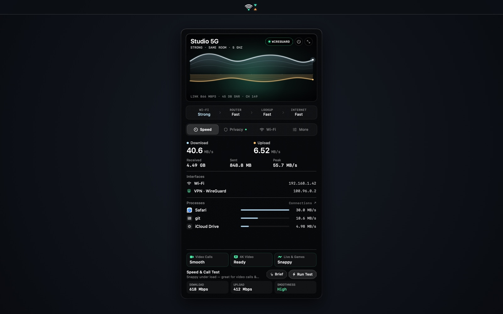
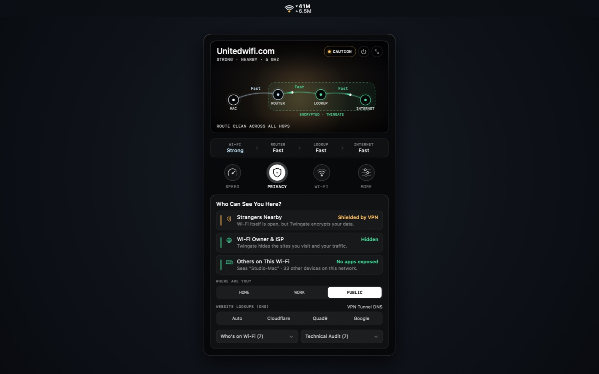
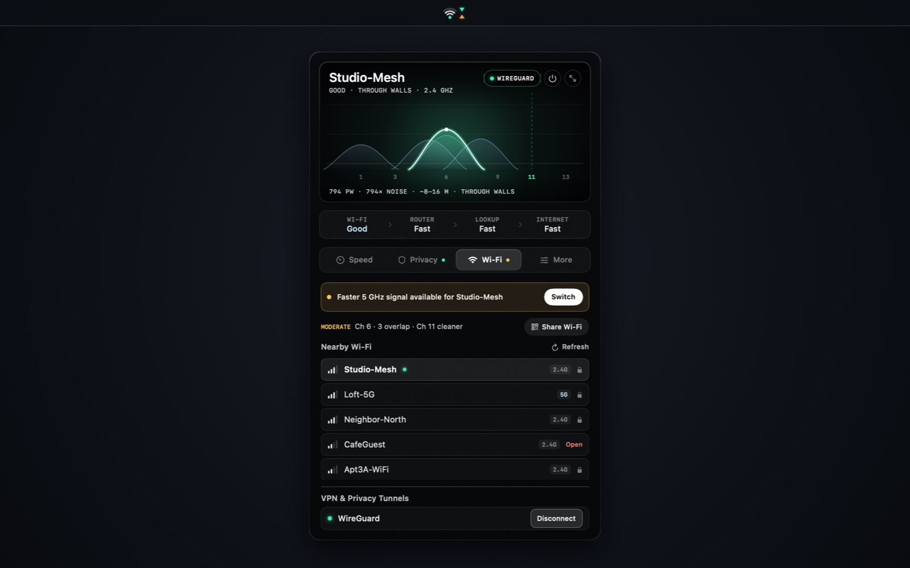
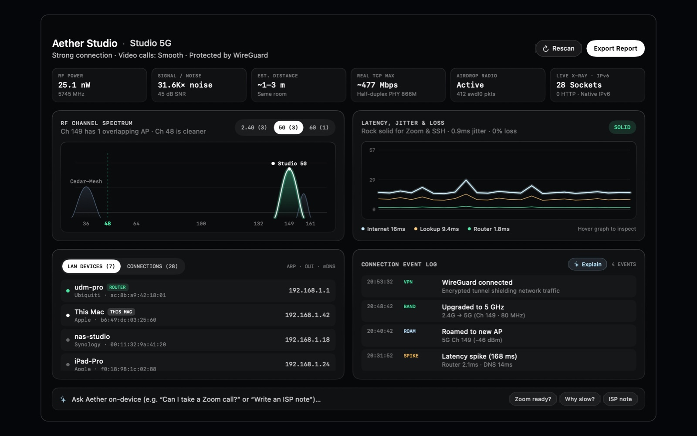
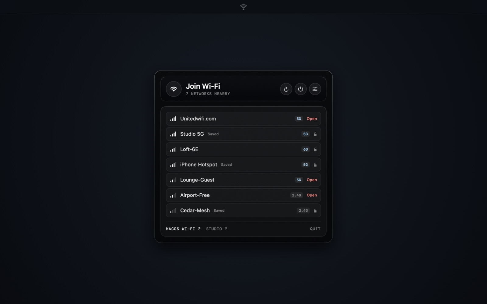

# Aether

**Aether** is a native macOS menu bar Wi-Fi instrument built to replace Apple’s default Wi-Fi menu. Zero subscriptions, zero Electron, zero third-party packages — a **3.2 MB** Swift 6 + SwiftUI + AppKit app (`0.0%` idle CPU) that brings live throughput, parent-grouped app bandwidth with real macOS icons, active interfaces, radio physics, channel spectrum analysis, unspoofable ICMP/TLS latency, LAN discovery, outbound connections, privacy posture, and on-device Apple `FoundationModels` diagnostics into one quiet obsidian panel.

**Website & live preview:** [strangechances.com/aether](https://strangechances.com/aether/)

<p align="center">
  
</p>

## Why Aether Exists

Apple’s built-in macOS Wi-Fi menu hasn’t fundamentally changed in two decades. It gives you three static arcs and a flat list of SSIDs. If your Zoom call starts freezing, your downloads stall, or you join an open airplane or café hotspot, macOS tells you nothing about *why*:

- Is the bottleneck your Wi-Fi radio, your router, DNS lookups, or the ISP upstream?
- Are three neighbors crowding your exact channel while an empty channel sits right next to it?
- Is your Mac stuck on 2.4 GHz when a stronger 5 GHz node of the same network is in range?
- Is a background app saturating your upload pipe and causing bufferbloat?
- On public Wi-Fi, is your VPN actually shielding lookups, are 30 strangers on the same subnet, or is a local dev port exposed on `0.0.0.0`?

Until now, answering those questions on macOS meant juggling six separate paid utilities — **WiFi Signal**, **WiFi Explorer Pro**, **PingPlotter / PeakHour**, **LanScan / Fing**, **iStat Menus**, and a handful of Terminal commands (`airport`, `arp -an`, `scutil --dns`, `nettop`, `lsof`, `networkQuality`). Aether integrates all of them directly into the menu bar Wi-Fi icon itself, translating raw telemetry into plain English first while keeping full RF and network depth one tap away.

---

## Five Views, One Quiet Instrument

| Menu Bar & Speed (`FLUX`) | Public Wi-Fi Privacy (`ROUTE`) |
| :---: | :---: |
|  |  |
| Live harmonic silk ribbons (`↓ / ↑`), fixed-width `28pt` menu bar icon with color-coded `▾ / ▴` speed arrows (zero bar shifting), 4-step health chain, `Download / Upload` + `Received / Sent / Peak`, active `Wi-Fi` & `VPN` interfaces, parent-grouped `Processes` with real macOS app icons, activity readiness, on-device `✦ Brief` diagnosis, and bufferbloat speed test. | Plain-English *"Who Can See You Here?"* breakdown (Strangers Nearby, Wi-Fi Owner & ISP, Others on This Wi-Fi), curved Bézier 4-hop route with frosted VPN shield, auto-`PUBLIC` trust zone detection on open or crowded Wi-Fi, and 1-click DNS switching. |

| RF Channel Spectrum & Roaming (`SPECTRUM`) | Aether Studio Workstation (`⌘E`) |
| :---: | :---: |
|  |  |
| Dual-pass Gaussian channel overlap across 2.4 / 5 / 6 GHz, cleaner-channel recommendations, sticky-client 5 GHz roaming nudges, Touch ID Wi-Fi Share QR code, and 1-click VPN toggles. | Expandable obsidian workstation combining a 6-cell RF physics & socket X-Ray bar (nanowatts, linear SNR multiplier, path-loss distance, half-duplex TCP ceiling, `awdl0` AirDrop radio, native IPv6), full channel spectrum, interactive hover-crosshair latency/jitter/loss timeline, OUI + mDNS LAN devices, live per-app outbound connections, event log with `✦ Explain`, and an on-device `Ask Aether` command bar. |

<p align="center">
  
</p>

When you aren’t connected to a network, Aether collapses the telemetry stage and becomes a focused **Join Wi-Fi** picker — showing signal bars, band tags (`6G`/`5G`/`2.4G`), `Saved` indicators for 1-click Keychain joins, and coral `Open` warnings.

---

## Install

### Direct Download
Download [Aether-1.0.0.dmg](https://github.com/graemecode/aether/releases/latest/download/Aether-1.0.0.dmg) (macOS 15 Sequoia or later, Apple Silicon), drag **Aether** into **Applications**, and launch. Hide Apple’s built-in Wi-Fi icon in **System Settings → Control Center → Wi-Fi** (`Don't Show in Menu Bar`) to use Aether as your primary Wi-Fi menu.

### Build from Source
```bash
git clone https://github.com/graemecode/aether.git
cd aether

# Run unit tests + build, sign, install to /Applications, and launch
./scripts/build-app.sh --install

# Build release .dmg
./scripts/build-app.sh --dmg
```

---

## Architecture

Aether is pure **Swift 6** with **zero external dependencies**, split into a deterministic, unit-tested telemetry library (`AetherCore`) and a native AppKit + SwiftUI menu bar & Studio shell (`Aether`):

```
Sources/
├── AetherCore/                     # Pure Swift 6 telemetry, RF physics & audit engine (zero UI)
│   ├── InterfaceCounters.swift     # Zero-subprocess getifaddrs: live bytes, Peak, active interfaces, MAC, awdl0, IPv6
│   ├── AppAttribution.swift        # Pure-Darwin proc_pidpath parent `.app` rollup & service port catalog
│   ├── NativeNetworkTelemetry.swift# In-process SCDynamicStore, SCNetworkConnection, sysctl ARP, SOCK_DGRAM ICMP
│   ├── WiFiController.swift        # CoreWLAN + CoreLocation radio snapshots, scans, roaming & association
│   ├── ChannelAnalyzer.swift       # 2.4/5/6 GHz overlap scoring, channel recommendation & sticky-client detector
│   ├── RFPhysics.swift             # dBm -> nanowatts, linear SNR ratio, indoor path-loss range & TCP ceiling
│   ├── ConnectionMonitor.swift     # Rolling median RTT/jitter/loss stability engine & event models
│   ├── TrustAnalyzer.swift         # Non-scareware security posture, Evil Twin & gateway ARP watch
│   ├── TrustStore.swift            # Per-network trust zones (auto-PUBLIC on open/crowded Wi-Fi) & gateway pinning
│   ├── HumanSummary.swift          # Plain-English activity readiness, 3-actor privacy story & live RF insights
│   ├── LocalNetworkAdvisor.swift   # On-device Apple FoundationModels synthesis (macOS 26+, weak-linked) + fallback
│   ├── OUIVendorLookup.swift       # Compact offline IEEE OUI vendor lookup
│   ├── NetworkProbes.swift         # Async timeout-bounded probes, 1s nettop delta, captive portal & direct tools
│   └── MenuBarPositioner.swift     # Notch-safe floating panel geometry
└── Aether/                         # Native AppKit + SwiftUI menu bar & Studio app
    ├── App/
    │   ├── AppDelegate.swift       # Fixed-width 396pt notch-safe NSPanel, global shortcuts & right-click menu
    │   └── AppState.swift          # Reactive state engine (0.0% idle CPU when closed)
    └── UI/
        ├── MenuBarIconView.swift   # Fixed-width 22pt (Icon) / 28pt (Color Arrows) / 50pt (Speed) emblem
        ├── AppIconCache.swift      # Cached macOS .app icons & monochrome daemon/CLI badges
        ├── InstrumentStageView.swift# FLUX ribbons, Gaussian SPECTRUM & curved Bézier ROUTE circuit
        ├── PopoverView.swift       # Single-shell obsidian instrument & disconnected-first Wi-Fi picker
        ├── StudioWindowController.swift # Resizable Aether Studio workstation (⌘E) with LAN & Connections views
        └── QRCodeView.swift        # Scannable Wi-Fi Share QR card
```

### Privacy & Security
- **100% local telemetry:** Signal metrics, ARP device lists, channel scans, and gateway fingerprints stay on your Mac.
- **Optional Location permission:** Used solely because macOS `CoreWLAN` redacts SSIDs and nearby Wi-Fi names without it. Location data never leaves your Mac.
- **Strictly on-demand external checks:** Public IP (`https://ipinfo.io/json`) and the sandbox responsiveness test (`speed.cloudflare.com`) only run when you explicitly click **Check** or **Run Test**.
- **Two clean build targets:** Direct Developer ID (`scripts/build-app.sh`) includes 1-click DNS switching, Keychain QR sharing, per-app bandwidth (`nettop`), and socket X-Ray (`lsof`); the Mac App Store target (`project.yml`, `APP_STORE`) strips all subprocesses at compile time and runs 100% on sandboxed native Apple frameworks.

---

## Shortcuts
- `⌘1`–`⌘4`: Switch tabs (`SPEED`, `PRIVACY`, `WI-FI`, `MORE`)
- `1`–`3`: Switch Hero Stage (`Flux`, `Spectrum`, `Route`)
- `⌘E`: Open Aether Studio · `⌘P`: Toggle Simple / Pro mode · `Space`: Run speed & responsiveness test · `R`: Rescan Wi-Fi · `⌥-Click` menu bar icon: Copy Local IP

## License

MIT — see [LICENSE](LICENSE).
